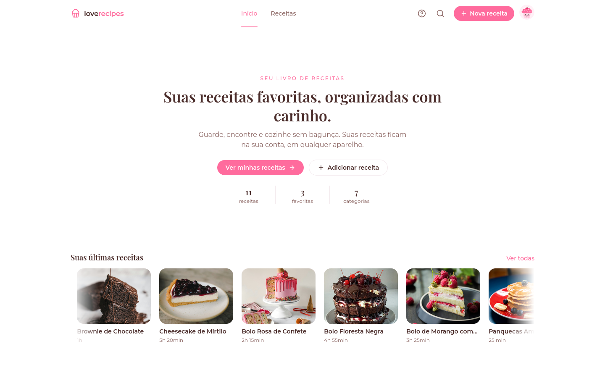

# Love Recipes React

<!-- markdownlint-disable MD033 -->

<div align="center">
  
  <h1><b>Love Recipes React</b></h1>
  <p>React app to organize your recipes with ingredients, step-by-step instructions and the time of each stage.</p>
  <p>
    
    
    
  </p>
</div>

<p align="center">
  
</p>

<!-- markdownlint-enable MD033 -->

## Table of Contents

- [Overview](#overview)
- [Features](#features)
- [Project Structure](#project-structure)
- [Prerequisites](#prerequisites)
- [Manual Installation (Ubuntu/Debian)](#manual-installation-ubuntudebian)
- [Supabase Setup](#supabase-setup)
- [Environment Configuration](#environment-configuration)
- [Running the Application](#running-the-application)
- [Pages](#pages)
- [How Data Is Protected](#how-data-is-protected)
- [Content Limits](#content-limits)
- [License](#license)

## Overview

The Love Recipes React was built around a real need of my girlfriend: a single place to write down favorite recipes and follow them step by step in the kitchen, instead of scattered notes and screenshots.

It is a recipe organizer developed with React, Vite and TypeScript, with a minimalist interface in pastel pink. Each user keeps their own recipe book: recipes with photo, ingredients, step-by-step instructions and the time of each stage (prep, oven, fridge and rest), organized by categories and favorites. There is no custom backend: authentication, database and photo storage run on Supabase, and the access rules live in the database itself.

## Features

- Login and register with email and password, strong password checklist and password recovery by email
- Home page with an auto-scrolling strip of the latest recipes
- Recipe list with category filters, favorites carousel and "load more" pagination
- Recipe details in a popup with fullscreen mode, times per stage, ingredient checklist and numbered steps
- New recipe form with photo upload (resized in the browser), time per stage and ingredient and step lists
- Custom categories with name and icon, plus a manager to create, rename and delete them
- Search overlay by name, ingredient or category, with keyboard navigation
- Favorites with optimistic updates and toast notifications
- Skeleton loaders with shimmer effect and smooth page transitions
- Cupcake character avatar with a flavor chosen per account
- Usage guide in the help popup

## Project Structure

```plaintext
└── love-recipes-react/
  ├── .github/
  │   ├── home.png
  │   └── love-recipes-logo.png
  ├── public/
  │   └── favicon.svg
  ├── src/
  │   ├── components/
  │   │   ├── auth/
  │   │   │   ├── AuthLayout.tsx
  │   │   │   ├── GoogleButton.tsx
  │   │   │   ├── PasswordRequirements.tsx
  │   │   │   └── RecipePreview.tsx
  │   │   ├── brand/
  │   │   │   ├── CupcakeAvatar.tsx
  │   │   │   └── Logo.tsx
  │   │   ├── category/
  │   │   │   ├── CategoryEditor.tsx
  │   │   │   └── CategoryManager.tsx
  │   │   ├── help/
  │   │   │   └── HelpModal.tsx
  │   │   ├── home/
  │   │   │   ├── FeaturedCategories.tsx
  │   │   │   └── RecentRecipesMarquee.tsx
  │   │   ├── layout/
  │   │   │   ├── AccountMenu.tsx
  │   │   │   ├── Header.tsx
  │   │   │   └── Splash.tsx
  │   │   ├── recipe/
  │   │   │   ├── RecipeCard.tsx
  │   │   │   ├── RecipeCarousel.tsx
  │   │   │   ├── RecipeForm.tsx
  │   │   │   ├── RecipeImage.tsx
  │   │   │   └── RecipeModal.tsx
  │   │   ├── search/
  │   │   │   └── SearchOverlay.tsx
  │   │   └── ui/
  │   │       ├── Dialog.tsx
  │   │       └── Skeleton.tsx
  │   ├── context/
  │   │   ├── AuthContext.tsx
  │   │   ├── CategoriesContext.tsx
  │   │   └── RecipesContext.tsx
  │   ├── data/
  │   │   └── categories.ts
  │   ├── hooks/
  │   │   ├── useAuth.ts
  │   │   ├── useCategories.ts
  │   │   ├── useHashRoute.ts
  │   │   └── useRecipes.ts
  │   ├── lib/
  │   │   ├── api.ts
  │   │   ├── image.ts
  │   │   ├── limits.ts
  │   │   ├── storage.ts
  │   │   ├── supabase.ts
  │   │   ├── text.ts
  │   │   ├── time.ts
  │   │   └── validation.ts
  │   ├── pages/
  │   │   ├── AuthPage.tsx
  │   │   ├── Home.tsx
  │   │   ├── NewRecipe.tsx
  │   │   ├── Recipes.tsx
  │   │   └── ResetPassword.tsx
  │   ├── types/
  │   │   ├── database.ts
  │   │   └── recipe.ts
  │   ├── App.tsx
  │   ├── index.css
  │   └── main.tsx
  ├── supabase/
  │   └── migrations/
  │       ├── 20261017120000_init.sql
  │       ├── 20261017140000_signup_email_validation.sql
  │       └── 20261017150000_content_limits.sql
  ├── .env.example
  ├── .gitignore
  ├── .oxlintrc.json
  ├── index.html
  ├── LICENSE
  ├── package.json
  ├── package-lock.json
  ├── README.md
  ├── SUPABASE_SETUP.md
  ├── tsconfig.app.json
  ├── tsconfig.json
  ├── tsconfig.node.json
  └── vite.config.ts
```

## Prerequisites

To run the Love Recipes React, use Ubuntu 22.04, 24.04 or 26.04 (or a similar Debian-based system) with Node.js 20.19 or higher and npm. The app needs a Supabase project (the free plan is enough) for authentication, database and photo storage.

## Manual Installation (Ubuntu/Debian)

Update system & install base dependencies

```sh
sudo apt update && sudo apt upgrade -y
sudo apt install -y git curl
```

### Install Node.js

Install Node.js 22 from the NodeSource repository:

```sh
curl -fsSL https://deb.nodesource.com/setup_22.x | sudo -E bash -
sudo apt install -y nodejs
```

For other systems, follow the official guide: [https://nodejs.org/en/download](https://nodejs.org/en/download)

## Supabase Setup

1. Create a Supabase project.
2. In **SQL Editor**, run the files in [`supabase/migrations/`](supabase/migrations/) in order.
3. In **Authentication → Hooks**, enable **Before User Created** with the Postgres function `public.hook_validate_signup`.
4. In **Authentication → URL Configuration**, set the **Site URL** to `http://localhost:5173` and add `http://localhost:5173/**` to the **Redirect URLs**.
5. In **Authentication → Sign In / Providers → Email**, set the minimum password length to `8` and require lowercase, uppercase, digits and symbols.
6. In **Authentication → Emails → SMTP Settings**, configure an SMTP server so password recovery emails reach any address.

The full step-by-step guide, including the optional Google login, is in [SUPABASE_SETUP.md](SUPABASE_SETUP.md).

## Environment Configuration

Configure environment variables

```sh
cp .env.example .env.local
```

Configure the environment variables in `.env.local`:

| Variable | Description |
| -------- | ----------- |
| `VITE_SUPABASE_URL` | Project URL, in **Project Settings → API**, for example `https://your-project.supabase.co` |
| `VITE_SUPABASE_PUBLISHABLE_KEY` | Publishable key (`sb_publishable_...`), in **Project Settings → API Keys** |
| `VITE_ENABLE_GOOGLE_LOGIN` | `true` shows the **Continuar com Google** button. Enable it only after configuring the Google provider in Supabase |

The publishable key is meant to be public: the data is protected by the database access rules, not by the key. Never put the `service_role` / secret key in the frontend.

Vite reads the variables when the server starts or the build runs, so restart `npm run dev` after changing `.env.local`.

## Running the Application

```sh
git clone https://github.com/id0ubl3g/love-recipes-react
cd love-recipes-react
npm install
npm run dev
```

The `npm run dev` command starts the Vite dev server on `http://localhost:5173`.

| Command | Description |
| ------- | ----------- |
| `npm run dev` | Start the dev server with hot reload |
| `npm run build` | Type-check and build the app into `dist/` |
| `npm run preview` | Serve the `dist/` build locally |
| `npm run lint` | Run Oxlint |

## Pages

The app uses hash routes, so it works on any static host without server rewrites.

| Route | Description |
| ----- | ----------- |
| `#/` | Home with the presentation and the strip of latest recipes. |
| `#/receitas` | Recipe list with category filters, favorites and category manager. |
| `#/nova` | Form to create a new recipe. |
| `#/receita/:id` | Recipe details in a popup over the current page. |

Without a logged-in user, every route shows the login and register screen. The password recovery link opens the screen to set a new password.

## How Data Is Protected

1. Every table has Row Level Security (RLS): each user reads and changes only their own recipes and categories.
2. Photos go to the `recipe-images` bucket, where each user can write only in their own folder. The bucket accepts JPG, PNG and WEBP up to 2 MB, and the app resizes photos to 1200 px before uploading.
3. The **Before User Created** hook runs inside Supabase Auth before each signup and rejects invalid emails, disposable domains and reserved domains, even for requests that skip the app.
4. Password rules are enforced by Supabase Auth and mirrored in the app as a live checklist.

## Content Limits

The same limits are enforced in the database and in the app ([`src/lib/limits.ts`](src/lib/limits.ts)), so change both together.

| Field | Limit |
| ----- | ----- |
| Title / description | 80 / 160 characters |
| Ingredients | 1 to 50 per recipe, up to 150 characters each |
| Steps | 1 to 30 per recipe, up to 600 characters each |
| Custom categories | 20 per user, name up to 24 characters |

## License

This project is licensed under the terms of the [Apache License 2.0](http://www.apache.org/licenses/LICENSE-2.0). See the [LICENSE](./LICENSE) file for details.
